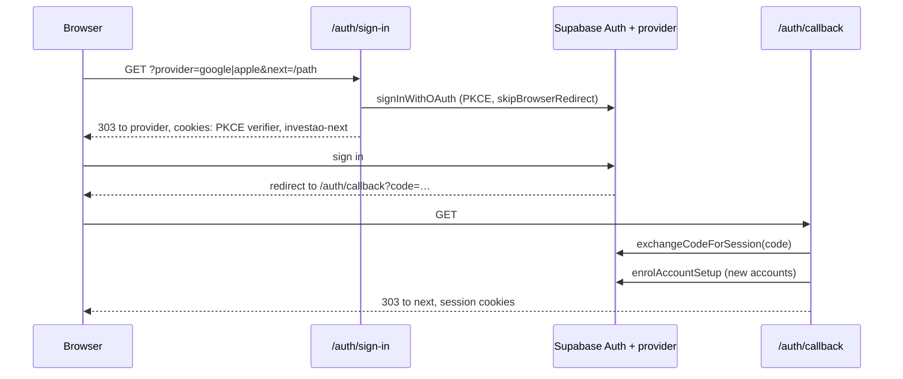
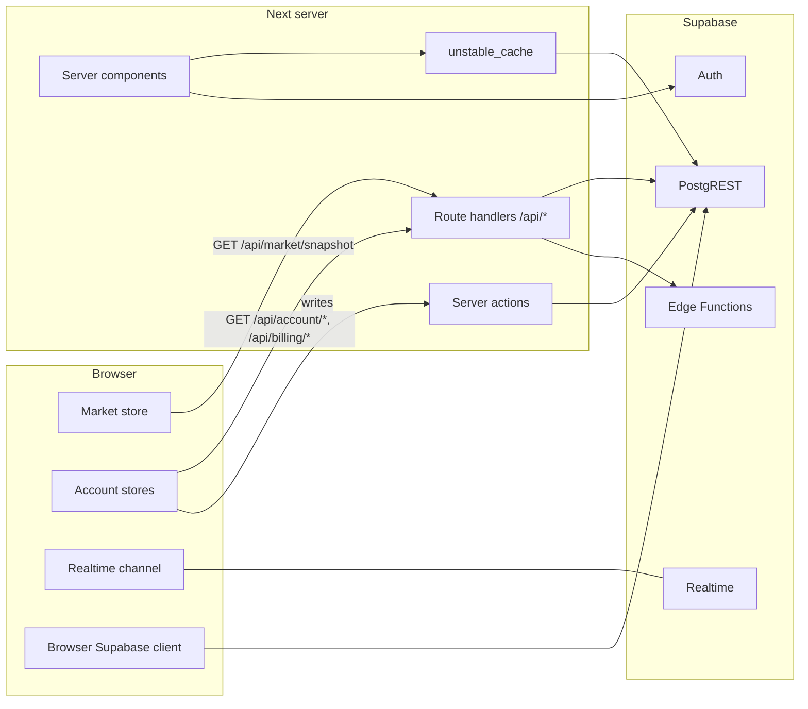

# Architecture

## Run modes

`NEXT_PUBLIC_DATA_MODE` selects one of three modes (`src/config/env.ts`).

| Mode | Backend | Behaviour |
|---|---|---|
| `demo` | None | Data comes from a recorded snapshot in `tests/fixtures/market` re-dated to the request time and from cookies (`src/data/market/demo`, `src/data/demo`). Sign-in buttons are disabled (`src/app/[locale]/(auth)/entrar/page.tsx`). No telemetry, no PostHog flag call (`src/data/telemetry/client.ts`, `src/data/flags/maintenance-gate.ts`) |
| `local` | A Supabase stack at the configured URL | Adds the route `/auth/local-password` and a password form on `/entrar` (`next.config.ts` `pageExtensions`, `src/app/auth/local-password/route.local.ts`) |
| `production` | The hosted Supabase project | `*.dev.tsx` routes (`/dev/design`, `/dev/market`) are not built (`next.config.ts`) |

Demo cookies are listed in [configuration.md](configuration.md).

## Hosts

`SITE_URL` is the public site's origin. `APP_URL`, when set to a different host, is the signed-in app's origin (`src/config/hosts.ts`, `src/config/server-env.ts`). The example in `.env.example` and the comments in `src/config/hosts.ts` name `invest.ao` and `dashboard.invest.ao`.

With both set (`hostSplit` returns a value), the proxy redirects with status 307 and `Cache-Control: private, no-store` (`src/proxy.ts`, `crossHostTarget`):

| Request | Result |
|---|---|
| Site host, signed-in path (see below) | Redirect to the same path on the app host |
| Site host, `/mercado…`, visitor has a session | Redirect to the same path on the app host |
| App host, `/` or `/en` | Redirect to `/inicio` or `/en/inicio` on the app host |
| App host, any path that is neither a signed-in path nor (for a signed-in visitor) `/mercado…` | Redirect to the same path on the site host |
| Any other host (for example a preview) | No redirect |

Requests that carry the `next-action` header (server actions) are never redirected across hosts.

Signed-in paths are `/inicio`, `/lista`, `/carteira`, `/pesquisa`, `/atividade`, `/atividade-invulgar`, `/semana`, `/simulador`, `/wrap`, `/planos`, `/definicoes` and everything below them, with or without the `/en` prefix (`src/features/shell/destinations.ts`).

Session cookies get `Domain=<site hostname>` when the app host is a subdomain of the site host, so both hosts read one session (`cookieDomainFor` in `src/config/hosts.ts`, used by `src/data/auth/request-client.ts` and `src/data/supabase/server-client.ts`). Sign-in and its callback run on the site host: the redirect to `/entrar` uses `hosts.siteOrigin` (`src/proxy.ts`), and `/auth/sign-in` sets `redirectTo` to `<request origin>/auth/callback` (`src/app/auth/sign-in/route.ts`).

Links from the site to a signed-in page use the app origin when the hosts are split (`src/features/site/app-href.ts`). The CSP `form-action` directive lists both origins (`src/proxy.ts`).

Without `APP_URL`, or when both URLs have the same host, one host serves every route.

## The proxy

`src/proxy.ts` runs on every path except `/api`, `/auth/`, `/_next`, `/_vercel` and paths containing a dot (its `config.matcher`). In order, it:

1. Creates a nonce and builds the Content-Security-Policy (`src/config/security.ts`).
2. Refreshes the session. Only requests with a session cookie reach Supabase (`auth.getSession()`). In demo mode "signed in" means a valid `demo-account` cookie. If Auth cannot be reached (`isAuthRetryableFetchError`), the state is `unavailable` and the cookies are kept.
3. Applies the cross-host redirect, if any.
4. Redirects a signed-in path without a session to `/entrar?next=…` (and `motivo=sessao` when a session cookie was present), clearing all Supabase cookies. This is skipped when the state is `unavailable` or the request is a server action.
5. Sets request headers `x-nonce`, `Content-Security-Policy`, `x-investao-path` (path and query) and, when unavailable, `x-investao-session: unavailable` (`src/data/auth/request-path.ts`).
6. Hands the request to the next-intl middleware for locale routing.
7. Sets the CSP response header, `Cache-Control: private, no-store` for signed-in paths and signed-in visitors, and copies refreshed cookies onto the response. A session cookie that could not be refreshed is cleared.

## Rendering

- Every page is rendered per request. `src/app/[locale]/layout.tsx` awaits `connection()` so the nonce from the proxy applies; `next.config.ts` states that Cache Components and Partial Prerendering are off for that reason.
- `experimental.staleTimes.dynamic` is 30 seconds: a page visited in the last 30 seconds is shown again from the browser's router cache (`next.config.ts`).
- The document (`<html>`, `<body>`) is rendered by `src/app/[locale]/layout.tsx`; `src/app/layout.tsx` only returns its children.
- Server components read data and pass plain values to client components. Money crosses that boundary as strings (for example `close.price.toString()` in `src/app/[locale]/(market)/mercado/[symbol]/page.tsx`).
- The server clock for a render is `requestTime()` (`src/data/clock.ts`); client components receive it as a prop (`renderedAt`).
- Server-rendered HTML shows the dated verified close. Current quotes are added in the browser by the market store ([features/market.md](features/market.md)).
- Route groups under `src/app/[locale]`:

| Group | Layout | Used for |
|---|---|---|
| `(site)` | `SiteFrame plus` (header, page, footer, Plus in the navigation) | Landing, news, lessons, invite, Plus, unknown paths |
| `(store-linked)` | `SiteFrame plus={false}` | `/policy`, `/termos`, `/suporte`, `/eliminar-conta`, `/partilha/[token]`. Plus is left out of the header and footer (`src/app/[locale]/(store-linked)/layout.tsx`) |
| `(market)` | App shell for a signed-in visitor, site chrome otherwise (`src/app/[locale]/(market)/layout.tsx`) | `/mercado` and below |
| `(auth)` | No chrome | `/entrar` |
| `(app)` | `requireAccount()`, then `SignedInFrame` | Signed-in pages |

- While the PostHog flag `web-maintenance` (`web-maintenance-development` outside production mode) is on, the locale layout renders `MaintenanceScreen` instead of any page (`src/data/flags/maintenance.ts`, `src/data/flags/maintenance-gate.ts`). The flag is refreshed in the background at most every 300 seconds; a positive answer counts for 3600 seconds; a failed read never blocks a page.

## Server caches

`unstable_cache` holds anonymous reads only. Revalidation times in seconds:

| Data | Seconds | Source |
|---|---|---|
| Catalogue (securities and verified closes) | 300 | `src/data/market/public-cache.ts` |
| Daily history per instrument and Luanda day | 3600 | same |
| Market index (pulse) per Luanda day | 3600 | same |
| Issuer, latest dividend, reports, recent dividends | 86400 | same |
| Issuer logo sources | 3600 | same |
| News page, news search, article | 60 | same |
| Benchmark rates | 3600 | same |
| Listing events | 300 | `src/data/market/listing.ts` |
| Released wrap periods | 300 | `src/data/account/wraps.ts` |
| Web plans as `anon` | 300 | `src/data/billing/public-plans.ts` |

`/api/market/snapshot` keeps the upstream body in memory for the upstream `max-age`, revalidates with `If-None-Match`, shares one upstream request between concurrent misses and passes failures through uncached with `Retry-After` (`src/data/market/snapshot-proxy.ts`). The cache is per server process.

`src/app/sitemap.ts` sets `revalidate = 3600`. The Open Graph cards under `/og/[image]` are generated at build time (`dynamicParams = false`, `src/app/og/[image]/route.tsx`).

## Auth flow

- Providers are Google and Apple only (`PROVIDERS` in `src/app/auth/sign-in/route.ts`). Google is asked with `prompt=select_account`; Apple with scopes `name email`.
- `next` is validated by `safeNextPath`: an absolute same-origin path, at most 2048 characters, never `/entrar` or `/auth` (`src/domain/auth/next-path.ts`). It is kept in the HttpOnly cookie `investao-next` (path `/auth/callback`, 600 seconds) (`src/data/auth/cookies.ts`).
- The callback answers 303 with `Cache-Control: private, no-store` and `Referrer-Policy: no-referrer`. A provider error other than a cancellation returns to `/entrar?motivo=falha` (`src/app/auth/callback/route.ts`).
- Session cookies are `HttpOnly`, `SameSite=Lax`, path `/`, and `Secure` on HTTPS (`sessionCookieOptions`).
- The server verifies the account with `auth.getClaims()` (the token's signature) in `currentAccount` (`src/data/auth/account.ts`) and `accountSession` (`src/data/account/session.ts`). Anonymous users (`is_anonymous`) are treated as signed out.
- `requireAccount` in the `(app)` layout redirects to `/entrar` when there is no account, or renders `SessionUnavailable` when the proxy reported `unavailable` (`src/features/shell/signed-in-frame.tsx`).
- A new account is enrolled in setup by writing `investao_onboarding_completed: false` to user metadata, then the session is refreshed (`enrolAccountSetup`). Accounts created before 2026-11-11 UTC without the flag skip setup (`WEB_ACCOUNT_SETUP_ROLLOUT` in `src/domain/auth/account.ts`).
- Sign-out is a form POST to `/auth/sign-out`. It calls `auth.signOut()` (all sessions), clears every `sb-` cookie, sends `Clear-Site-Data: "cache"` and redirects to `/entrar`; if revocation failed the redirect carries `motivo=local` (`src/app/auth/sign-out/route.ts`). The browser clears its account state first (`src/features/auth/sign-out-form.tsx`, `src/features/auth/account-state.ts`).
- When a browser read learns the session is gone, `reauthenticate()` clears the tab's account state and navigates to `/entrar?next=…&motivo=sessao` once per tab (`src/features/auth/reauthenticate.ts`).

## Data flow

- Edge Functions are called only from the server: `market-snapshot` (`src/app/api/market/snapshot/route.ts`), `web-checkout` and `web-order-status` (`src/data/billing/web-passes.ts`), `apple-web-deletion/start` (`src/data/account/deletion.ts`). A Playwright test asserts the browser never requests one (`tests/e2e/market.spec.ts`).
- Account reads go through `/api/account/*` and `/api/billing/*`. Every answer carries `userID`; the browser discards an answer for another account (`readAccountRoute` in `src/features/account/results.ts`). These responses are `private, no-store` (`ACCOUNT_HEADERS` in `src/data/account/session.ts`).
- Account writes are server actions. Each takes the expected user id and returns `ok`, `stale` (the session is another account; nothing was written) or `failed` with a typed error (`src/features/account/write.ts`).
- The browser Supabase client (`src/data/supabase/browser-client.ts`) is used for the Realtime channel and the market store's direct reads (`src/features/market/market-provider.tsx`), the feature-control document (`src/data/intelligence/feature-config.ts`) and the personalisation sync (`src/data/personalisation/personalisation.ts`).
- All Supabase clients share `CLIENT_OPTIONS`: PostgREST retries off, a 20-second timeout per request, and JSON rewritten so long numerics keep their digits (`src/data/supabase/options.ts`, `src/data/http/exact-fetch.ts`).

The full list of backend calls is in [data-layer.md](data-layer.md).

## Code layers

| Layer | Rule | Enforced by |
|---|---|---|
| `src/domain` | Imports only from `src/domain`; no React, Next.js, Supabase or `server-only` | `eslint.config.mjs` |
| `src/domain` (non-test) | No `parseFloat`, `Number.parseFloat`, `.toNumber()` or `.toNearestNumber()` | `eslint.config.mjs` |
| `src/config/server-env.ts` | `import "server-only"` | The module itself |

Financial values are `Decimal` (`decimal.js`) in the domain layer.

## Browser state

- One market store per tab (`src/data/market/store.ts`, `src/features/market/market-provider.tsx`).
- Per signed-in tab, `AccountProvider` creates the access, watchlist, alerts, activity, preferences and portfolio stores (`src/features/account/account-provider.tsx`).
- The weekly reading is cached in IndexedDB (`src/data/intelligence/cache-store.ts`).
- `localStorage` and `sessionStorage` keys are listed in [configuration.md](configuration.md).
- There is no service worker and no offline mode. When the browser is offline, current quotes are revoked and `OfflineBanner` is shown (`src/data/market/store.ts`, `src/ui/components/feedback.tsx`).
