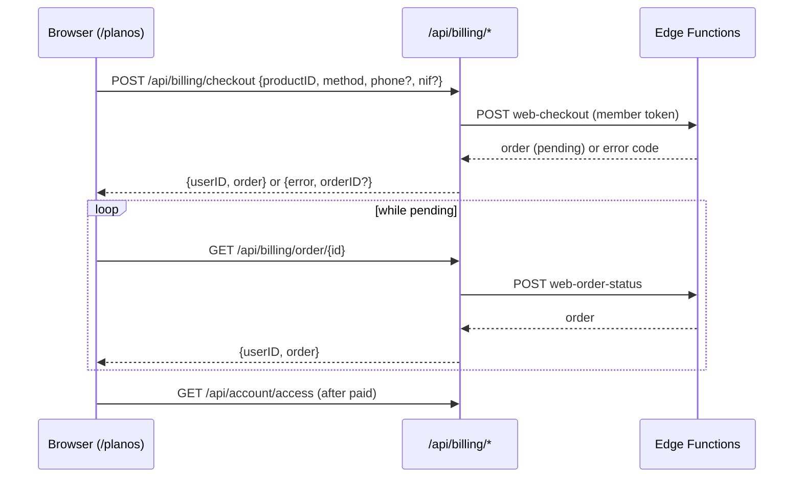

# Plus and web passes

Plus is the only paid plan the web knows (`src/domain/billing/web-pass.ts`, `src/domain/account/access.ts`). On the web it is bought as a prepaid pass in kwanzas. A pass is not renewed.

## Plan access

The server document `get_subscription_access()` is decoded into `SubscriptionAccess` (`src/domain/account/access.ts`):

| Field | From | Meaning in the web |
|---|---|---|
| `isPlus` | `is_plus` | The account has Plus |
| `enforcementEnabled` | `enforcement_enabled` | The server applies Free limits to this account |
| `weekStart`, `resetsAt` | `week_start`, `resets_at` | The Free comparison week |
| `comparisonPair` | `comparison_pair` | The Free pair claimed this week |
| `activeWatchlistIDs` | `active_watchlist_ids` | Watchlist rows that count for a Free account |
| `movementSecurityID` | `movement_security_id` | The instrument with automatic movements on Free |
| `plusUntil` | `plus_until` | End of paid Plus; null for Free or lifetime Plus |
| `storeSubscription` | `store_subscription` | An App Store subscription is active |

It is read on the server for the app shell (`readAccountState` in `src/features/account/state.ts`) and re-read in the browser through `/api/account/access` after watchlist changes and after a payment (`AccessStore` in `src/features/account/account-provider.tsx`, `src/features/billing/plans-view.tsx`).

## Gating

`unlocksPlus(access)` is true when the access document is missing, when `enforcementEnabled` is false, or when `isPlus` is true. Only when it is false does the web lock a Plus feature. The server enforces its own limits regardless.

Client-side constants (`FREE_PLAN_LIMITS`): watchlist 3, automatic-movement instruments 1, comparison instruments 2 (3 with Plus), order-book levels 5.

Where the web checks `unlocksPlus` before acting:

| Feature | File |
|---|---|
| `Tudo` history range on the instrument page and the market session sheet | `src/features/market/instrument/instrument-view.tsx`, `src/features/home/market-session-sheet.tsx` |
| Price history CSV export, liquidity section, order-book depth beyond 5 levels | `src/features/market/instrument/account-panels.tsx` |
| Named portfolios, share links | `src/features/portfolio/book-menu.tsx` |
| Statement reading | `src/features/portfolio/csv-transfer.tsx` |
| Cash, benchmark, year report | `src/features/portfolio/summary-sections.tsx` |
| Income totals | `src/features/portfolio/income-view.tsx` |
| Watchlist groups | `src/features/watchlist/watchlist-view.tsx` |

Limits that only the server knows arrive as `P0001` errors and are mapped to an upgrade reason (`src/domain/errors/rules.ts`): watchlist size, automatic movements, alert rules, comparison size and weekly pair, portfolios, cash, groups, share links.

A locked feature opens one dialog: the title `invest.ao Plus`, the reason sentence (`UPGRADE_REASON_KEYS`) and an "OK" button (`src/features/account/account-provider.tsx`).

A Free account under enforcement chooses its three active instruments and its one automatic-movement instrument in `FreeSelectionDialog`, saved with `select_free_watchlist` (`src/features/watchlist/free-selection-dialog.tsx`).

## Products

Products and prices come only from `get_web_plans()`; no price is written in the code outside demo mode (`src/domain/billing/web-pass.ts`, `src/data/demo/web-pass-ledger.ts`). A plan has `id`, `months` and `priceAOA`. The code comments name the ids `plus_1m` and `plus_12m`.

`annualSaving` compares the 12-month plan with twelve 1-month plans and returns a saving only when the year is cheaper; the percentage is rounded down.

Payment methods: `mcx_express` (a push to a mobile number) and `reference` (entity and reference to pay at an ATM or in online banking).

## The public Plus page

`/plus` (`src/app/[locale]/(site)/plus/page.tsx`):

- Reads `get_web_plans()` as `anon`, cached for 300 seconds. A failed read or an empty list is treated as "no passes on sale" (`src/data/billing/public-plans.ts`).
- With passes on sale: the pass cards with their prices, the payment methods line, and one pill to `/planos` on the app host. Below the comparison, a band with the App Store button.
- With none: the hero shows the App Store button; no price, no payment method and no pay action appear.
- The comparison table (Free against Plus) is built from message keys and two counts written in the page (portfolios 1 and 10, alert rules 2, groups 20).
- The page is not linked from `(store-linked)` pages: their header and footer leave Plus out (`src/app/[locale]/(store-linked)/layout.tsx`).

The landing page has a Plus section with three benefits, a link to `/plus` and the App Store button (`src/app/[locale]/(site)/(home)/page.tsx`).

## Home prompt

`PlusPrompt` on `/inicio` (`src/features/home/plus-prompt.tsx`, `src/domain/billing/plus-prompt.ts`):

- `offer`: limits apply and the account has no Plus.
- `renew`: prepaid Plus ends within 7 days (`PLUS_RENEW_WINDOW_MS`). Never for an App Store subscriber or lifetime Plus.
- Shown only when `/api/billing/plans` returns at least one plan. The plans are read once per page view and only when the access document already allows a prompt.
- A dismissed offer stays away 30 days (`PLUS_OFFER_SNOOZE_MS`). A dismissed renew prompt stays away for that end date; the stored key is an FNV-1a hash of the date. The dismissal is kept per account in this browser.

## Checkout on `/planos`

`PlansView` (`src/features/billing/plans-view.tsx`) loads `/api/billing/plans` (plans and orders) and shows one of:

| State | View |
|---|---|
| The account has a pending order | The pending order, on every visit, until it settles |
| An order settled during this visit | How it ended (`OrderOutcome`) |
| Free, passes on sale | The purchase form |
| Plus | The plan status; the purchase opens from "Adicionar tempo" |
| No passes on sale | Free: the App Store; Plus: the status only |

The header shows the plan as the access document has it: Free, Plus and its end date, or lifetime Plus (`src/features/billing/plan-status.tsx`).

### Form

`CheckoutForm` (`src/features/billing/checkout-form.tsx`): the plan (12 months first, with its saving), the price, the payment method, a phone number for Express, an optional NIF, and one button that states the amount. Fields are checked on submit. `angolanMobile` and `webOrderNIF` (`src/domain/billing/web-pass.ts`) apply the same formats as the server.

### Request

- `POST /api/billing/checkout` requires a same-origin POST and a session (`src/app/api/billing/checkout/route.ts`). The phone and NIF go only into the Edge Function's JSON body (`src/data/billing/web-passes.ts`).
- `WEB_ORDER_PENDING` from the server carries `details.order_id`; the page resumes that order instead of showing an error.

### Failures

Edge Function error codes map to failures, and each failure to the HTTP status the route answers (`FAILURE_CODES`, `WEB_CHECKOUT_FAILURE_STATUS`):

| Server code | Failure | Status |
|---|---|---|
| `INVALID_JSON`, `INVALID_INPUT` | `invalidInput` | 400 |
| `INVALID_PHONE` | `invalidPhone` | 400 |
| `WEB_ORDER_NIF_INVALID` | `invalidNIF` | 400 |
| `UNAUTHENTICATED` | `signedOut` | 401 |
| `WEB_PASSES_CLOSED` | `closed` | 403 |
| `WEB_ORDER_NOT_FOUND` | `notFound` | 404 |
| `WEB_PRODUCT_UNAVAILABLE` | `productUnavailable` | 409 |
| `WEB_PASS_NOT_NEEDED` | `notNeeded` | 409 |
| `WEB_ORDER_PENDING` | `pending` | 409 |
| `WEB_ORDER_RATE_LIMIT` | `rateLimited` | 429 |
| `PAYMENT_GATEWAY_UNAVAILABLE` | `gatewayUnavailable` | 502 |
| `PAYMENTS_NOT_CONFIGURED` | `notConfigured` | 503 |
| Transport failure, unknown code, undecodable body | `unavailable` | 503 |

An unknown code falls back on the status: 401 `signedOut`, 404 `notFound`, 429 `rateLimited`.

`invalidPhone` and `invalidNIF` are shown on their field; other failures above the button.

## Order status

Order statuses: `pending`, `paid`, `expired`, `failed`, `refunded`, `cancelled`. An order has `id`, `productID`, `months`, `amountAOA`, `method`, `status`, `reference` (`entity`, `reference`; reference orders only), `expiresAt`, `paidAt`, `createdAt` and `pass` (`startsAt`, `endsAt`).

`useOrderPolling` (`src/features/billing/use-order-polling.ts`) reads `/api/billing/order/[id]`:

- every 3 seconds (`WEB_ORDER_POLL_MS`);
- once a minute for a reference order older than ten minutes;
- not while the tab is hidden; once on return;
- once more after `expiresAt`, then it stops and an order still pending is shown as expired;
- a failed read waits for the next tick.

Pending views (`src/features/billing/order-views.tsx`): Express shows the amount, the time left and a cancel button; reference shows entity, reference and amount, each with a copy button.

Cancel: `POST /api/billing/order/[id]/cancel` calls `cancel_web_order`.

When an order becomes `paid`, the page re-reads the access document so the rest of the app unlocks.

## Past orders

`OrderHistory` lists settled orders (every status but `pending`), newest first, at most 10 (`WEB_ORDER_HISTORY_LIMIT`), from the `get_web_orders` answer. A row is dated by `paidAt` for a paid order, otherwise `createdAt`.

## Demo mode

Demo orders live in the `demo-web-orders` cookie (at most 12). An Express order to a phone ending `0001` is paid after 5 seconds, `0002` fails at once, any other expires with the order; a reference order is paid after 20 seconds. `demo-plans=closed` makes the plans list empty and checkout answer `closed`. Demo accounts `plus` and `pro` stand for an App Store subscriber (`src/data/demo/web-passes.ts`, `src/data/demo/web-pass-ledger.ts`).

## Tests

`tests/e2e/plans.spec.ts`, `tests/e2e/plus.spec.ts`, `src/domain/billing/web-pass.test.ts`, `src/domain/billing/plus-prompt.test.ts`, `src/data/demo/web-pass-ledger.test.ts`.
